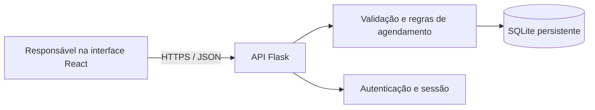

# Projeto de Software — GP Agenda

**Parceiro:** GP Estética Automotiva, pequeno negócio de estética automotiva em garagem.  
**Contato:** Ronaldo, responsável pelo negócio.  
**Diagnóstico informado pelo estudante:** conversa presencial em 12/11/2026.  
**Problemas apontados:** horários, cadastro de clientes, orçamento e controle de serviços.  
**Prazo exibido no DreamShaper:** 17/11/2026, 23h59.  
**Estado deste documento:** piloto local implementado e fotos de campo coletadas. Publicação, validação com Ronaldo e medição de impacto estão pendentes.

## Experiência Prática I — diagnóstico e planejamento

### Parceiro e problema

A GP Estética Automotiva atende proprietários de veículos por meio de serviços de estética automotiva. Ronaldo é o contato da organização. Na conversa presencial de 12/11/2026 ele apontou dificuldades em conciliar horários, manter cadastros, registrar orçamentos e acompanhar o status dos serviços. Segundo o relato complementar de 17/11/2026, os clientes solicitam horários presencialmente e Ronaldo guarda de memória a hora combinada. O volume de atendimentos e as perdas decorrentes desse processo ainda não foram medidos.

### Método e evidências

A investigação começou com uma **conversa exploratória presencial** em 12/11/2026, sintetizada pelo estudante. Em 17/11/2026 foram registradas duas fotos da garagem, mostrando a área de recebimento dos carros e o espaço de trabalho com ferramentas e insumos. O processo de marcação de memória foi descrito no relato complementar. O uso do GP Agenda será documentado depois de um teste real com Ronaldo.

### Público e persona

- **Usuário principal confirmado:** Ronaldo, gestor que organiza os atendimentos.
- **Público afetado:** clientes da GP que solicitam serviços e recebem orçamentos.
- **Persona de projeto, construída como hipótese:** gestor de uma estética automotiva pequena, que alterna entre execução dos serviços e atendimento. Precisa identificar rapidamente o cliente, o veículo, o horário, o orçamento e o próximo passo. A persona deve ser validada com Ronaldo antes de ser descrita como observação de campo.

### ODS e justificativa

O projeto se relaciona ao **ODS 8, meta 8.3**, por apoiar a organização de um pequeno empreendimento e sua capacidade de atender com previsibilidade. A meta da ONU trata de atividades produtivas, empreendedorismo e crescimento de micro, pequenas e médias empresas. A existência do software não comprova impacto econômico; isso exige indicadores medidos depois do uso. Fonte: [ONU Brasil, ODS 8](https://brasil.un.org/pt-br/sdgs/08).

### MVP

**GP Agenda**: aplicação web para uso do responsável pela estética. Ela permite cadastrar clientes e veículos, definir serviço e duração, registrar preço base e orçamento por atendimento, reservar horário sem sobreposição e acompanhar os status agendado, confirmado, em execução, concluído e cancelado. O acesso exige usuário e senha.

### Escopo e histórias de usuário

| Prioridade | História | Critério de aceitação |
| --- | --- | --- |
| Alta | Como Ronaldo, quero cadastrar cliente e veículo para localizar as informações no atendimento. | Cadastro aparece na lista e pode ser usado em um agendamento. |
| Alta | Como Ronaldo, quero cadastrar serviços com duração e preço base para montar orçamentos. | Serviço fica selecionável e mostra duração e valor. |
| Alta | Como Ronaldo, quero reservar um horário para evitar conflitos. | Uma segunda reserva sobreposta a outra ativa recebe erro e não é salva. |
| Alta | Como Ronaldo, quero registrar o orçamento combinado para consultar o valor. | Valor aparece em reais na fila de serviços. |
| Alta | Como Ronaldo, quero mudar o status para acompanhar a execução. | Mudança fica persistida e aparece na visão geral. |
| Média | Como Ronaldo, quero consultar próximos atendimentos para planejar o dia. | Próximo horário futuro e agendamentos recentes aparecem no painel. |

Fora deste MVP: portal público de autoagendamento, envio de mensagens, pagamento, emissão fiscal, estoque e múltiplas unidades. Esses itens só entram após validação das prioridades com Ronaldo.

### Cronograma de trabalho

| Data | Entrega |
| --- | --- |
| 12/11 | Conversa inicial com Ronaldo, informada pelo estudante. |
| 13/11 | Diagnóstico, protótipo funcional, testes locais e documentação. |
| 14/11 | Revisão do fluxo e coleta de evidências da garagem/conversa. |
| 15/11 | Teste guiado com Ronaldo e ajustes conforme feedback real. |
| 16/11 | Publicação, checagem de segurança e medição inicial, se houver infraestrutura. |
| 17/11 | Revisão e envio das quatro experiências antes de 23h59. |

As datas futuras são planejamento, não execução já realizada.

### Indicadores

| Indicador | Como medir | Linha de base | Meta de validação |
| --- | --- | --- | --- |
| Conflitos de horário no software | Criar duas reservas sobrepostas e verificar bloqueio | Não se aplica ao sistema anterior; falta apurar | 100% das sobreposições de teste bloqueadas |
| Tempo para cadastrar cliente e agendar | Cronometrar tarefa com Ronaldo | Pendente | Medir e comparar antes/depois |
| Completude dos registros | Verificar cliente, veículo, serviço, orçamento e status | Pendente | 100% das ordens de teste com campos essenciais |
| Facilidade de uso | Três tarefas observadas e nota de 1 a 5 dada por Ronaldo | Pendente | Pelo menos 4/5, sujeita à validação |

## Experiência Prática II — fundamentação e desenho do MVP

### Conexão curricular

O material oficial da Unidade II apresenta o **SDLC ágil** como ciclo iterativo de planejamento, desenho, desenvolvimento, teste, entrega e feedback. O GP Agenda seguiu esse percurso: problema identificado, MVP delimitado, implementação, testes e roteiro de validação. A mesma unidade discute **arquitetura em camadas/cliente-servidor**: a interface React é a apresentação, o Flask aplica regras de negócio e o SQLite persiste os dados. A separação permite revisar a experiência visual sem trocar as regras de bloqueio de horário. O conteúdo também aborda testes automatizados e manutenção como práticas de qualidade. Fonte: *Fábrica de Software e Ciclo de Desenvolvimento: Da Ideia ao Impacto Social*, Unidade II, Cruzeiro do Sul Virtual, páginas 3 e 4 de 11, acessadas em 13/11/2026.

Como competência do perfil de egresso, o trabalho exercita analisar um problema real, modelar uma solução, implementá-la e verificar seus resultados. A redação oficial do perfil deve ser conferida no plano da disciplina antes do envio.

### Soluções existentes

| Solução | Ponto forte documentado | Limite para o problema da GP | Decisão no MVP |
| --- | --- | --- | --- |
| [Google Calendar — agenda de compromissos](https://support.google.com/calendar/answer/11608416?hl=en) | Disponibilidade, página de reserva e prevenção de conflito com eventos do calendário. | Não é um fluxo específico de orçamento e status de serviço automotivo; essa é uma análise do caso de uso, não uma afirmação de ausência de todos os recursos. | Unir horário, cliente, veículo, serviço, orçamento e status numa ordem. |
| [Calendly — tipos de evento](https://calendly.com/help/how-to-set-up-an-event-type) | Configuração de duração, disponibilidade e página de reserva por tipo de evento. | Foco principal é marcar reuniões/compromissos; a GP também precisa acompanhar execução e valor de cada serviço. | Manter duração por serviço e adicionar acompanhamento operacional. |

### Arquitetura lógica

O frontend é React com Vite. O backend é Python/Flask; o servidor WSGI local é Waitress. O banco é SQLite por simplicidade do MVP de um único responsável. Uma implantação pública com mais usuários e concorrência precisaria de banco gerenciado e política de backup.

### Modelo simplificado de dados

| Entidade | Atributos principais |
| --- | --- |
| Usuário | id, nome de usuário, hash da senha |
| Cliente | id, nome, telefone opcional, veículo, observações |
| Serviço | id, nome, duração em minutos, preço base em centavos, ativo |
| Agendamento | id, cliente_id, serviço_id, início, fim, orçamento em centavos, status, observações |

Relacionamentos: Cliente 1:N Agendamento; Serviço 1:N Agendamento. Valores monetários são inteiros em centavos para evitar erros de ponto flutuante. Datas são gravadas como texto ISO local; a localização do servidor deve ser explicitada antes de implantação pública.

### Requisitos funcionais e não funcionais

RF01 cadastrar cliente; RF02 cadastrar serviço; RF03 agendar; RF04 impedir sobreposição; RF05 registrar orçamento; RF06 mudar status; RF07 consultar fila e próximo atendimento. Esses requisitos estão implementados.

RNF01 autenticação com hash scrypt; RNF02 CSRF nos métodos de escrita; RNF03 consultas SQL parametrizadas; RNF04 cabeçalhos de segurança e cookies HttpOnly/SameSite; RNF05 interface responsiva e rotulada para teclado e leitor de tela; RNF06 meta de resposta p95 abaixo de 1 s em teste local com 100 registros (ainda precisa ser medida). A proteção de dados considera minimização: telefone e observações são opcionais.

### Protótipo e fluxos

1. **Visão da garagem:** próximo atendimento, contadores, fila e atalhos.
2. **Clientes/Serviços:** cadastro dos dados necessários.
3. **Reservar horário:** seleção de cliente e serviço, data, orçamento, validação de conflito e resumo.

O protótipo é a aplicação React funcional em `/studio`. Há foco visível, rótulos nos campos, estados de erro em texto e suporte a movimento reduzido. A relação com o ODS 8 está no ganho potencial de organização do pequeno negócio, a ser aferido com Ronaldo.

### Plano de validação prática

Participante-alvo: Ronaldo, após concordância. Tarefas observáveis:

1. Cadastrar um cliente e veículo fictícios em até 2 minutos.
2. Cadastrar um serviço, montar um orçamento e reservar horário em até 3 minutos.
3. Tentar reservar o mesmo intervalo, reconhecer o bloqueio e concluir a primeira ordem.

Registrar tempo, sucesso sem ajuda, dúvidas, erros e nota de satisfação de 1 a 5. Critério inicial: 3/3 tarefas concluídas, sobreposição bloqueada e nota ≥4. Nenhum resultado de usuário foi informado até o momento.

## Experiência Prática III — implementação e evidências

### Repositório e revisão

O código está organizado em `app.py`, `frontend/`, `tests/` e `docs/`. O workflow `.github/workflows/ci.yml` executa testes Python e build React em push e PR. Histórico remoto de commits, pull requests e execução do GitHub Actions ainda precisam ser criados e documentados depois de publicar o repositório.

### Testes automatizados já executados localmente

- Autenticação impede acesso anônimo e rejeita senha errada.
- Formulários rejeitam POST sem token CSRF.
- Serviço e cliente são cadastrados.
- Agendamento grava orçamento em centavos.
- Um segundo agendamento sobreposto recebe erro 409 e não é salvo.
- Horário cancelado volta a ficar disponível; reativação com conflito é recusada.
- Mudança para concluído persiste.

Comando: `python -m unittest discover -s tests -v`. Os resultados exatos devem ser capturados no momento do envio; não se atribui aqui uma cobertura percentual ainda não calculada.

### Evidências de funcionamento

As capturas devem mostrar: entrada do responsável, visão da garagem, lista de clientes e serviços, formulário preenchido, bloqueio de horário sobreposto, alteração de status e saída de `npm run build`/testes. Os registros fictícios usados em capturas precisam ser identificados como demonstração.

### Validação com a comunidade

Primeira rodada: roteiro de três tarefas da Experiência II com Ronaldo. Segunda rodada: repetir após corrigir os pontos observados. Registrar data, tarefas, duração, comentário literal autorizado e mudança correspondente no código. Essas rodadas não foram realizadas nesta data.

## Experiência Prática IV — avaliação de impacto e encerramento

### Implementação versus escopo

Implementado: autenticação, cadastro, catálogo, duração, orçamento, bloqueio de conflito, status, visão geral e interface responsiva. Não implementado: autoagendamento público, notificações, emissão fiscal, pagamento ou relatórios financeiros. Essa delimitação mantém o MVP verificável.

### Publicação e monitoramento

O servidor local é um protótipo funcional. Publicação pública ainda não foi realizada. Para disponibilizar a Ronaldo com dados reais: domínio HTTPS, segredo persistente, banco persistente com backup, monitoramento do endpoint `/health`, logs sem dados pessoais e política de acesso. O endereço final e o resultado do monitoramento devem ser registrados apenas após o deploy comprovado.

### Ética e proteção de dados

Dados de clientes devem ser usados somente para a finalidade de atendimento autorizada pela GP. O protótipo minimiza a coleta, não exige telefone e não expõe uma página pública de clientes. Não publicar banco local, senhas ou capturas com dados pessoais. Solicitar autorização de Ronaldo antes de usar imagens da garagem ou feedback nominal no relatório acadêmico.

### Indicadores e impacto

O teste automatizado comprova prevenção de sobreposição **dentro da aplicação**. Não comprova redução real de atrasos, aumento de receita ou melhoria econômica. Esses resultados dependem de uma linha de base, uso com Ronaldo e coleta posterior. A conexão com o ODS 8.3 deve ser apresentada como contribuição potencial até haver medição de campo.

### Termo de feedback

Preparar um termo curto com identificação da GP, versão testada, data, tarefas executadas, pontos positivos, dificuldades, sugestões, autorização de uso do feedback no curso e confirmação de Ronaldo. O termo deve ser preenchido pelo próprio participante ou com suas respostas reais, sem assinatura simulada.
